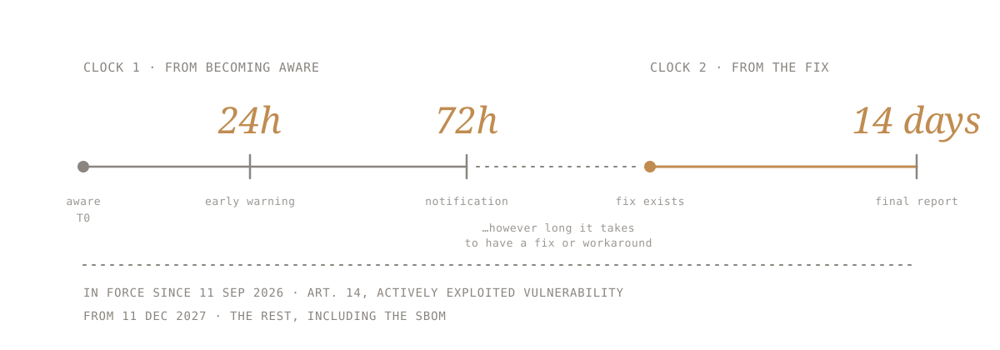

## The AI conundrum

There is a question I get asked a lot, usually by people who know I have been doing this for a while:

is the world less safe now, with AI?

My answer hasn't changed. AI is a tool, and attackers and defenders use exactly the same one. It's like those mecha films: a giant monster shows up to flatten a city, and there is always a giant robot, the same size, that fights it. Same tool, same capabilities on both sides. What makes the difference is the pilot. I call it the AI conundrum.

Leave aside the new attack surface, the models and the AI systems themselves, which is a real but separate problem. The attacks come from the same places and work the same way they always did: a phishing email, a reused password, an unpatched library, a forgotten server. What changed is who carries them out. A machine, not a person, and at the speed a machine runs. Everything is as it was before AI, only at the speed of light.

## Discovery got cheap

At my last company we built a tool that found vulnerabilities in WordPress plugins. Not triage. Discovery. It matched code against a corpus of vulnerabilities and proofs of concept we already had, and a human checked every hit, because the false positives came back confident, well written... and impossible to reproduce. It worked, sort of. It found real bugs.

The lesson I took from it wasn't about the tool. It was simpler: if a team of three people could build that, so can anyone with a similar corpus and a free weekend. And most likely some of them are not on your side.

For twenty years the hard, expensive part of software security was finding the bug. A lot of what we call security was built on that economics: make finding and exploiting the flaw expensive enough that most attackers go and bother someone else. That is what paid for researchers, bug bounties and pentests, and it's why obscurity worked for longer than anyone likes to admit. It doesn't work any more. Finding got cheap, for everyone at once, and a defence based on cost collapses consequently.

What didn't get cheap is what happens after someone finds something in your code or infra, the response.

## What "responding" actually means

Responding is these three questions, in order:

- **How fast do you hear about it?**
- **How fast do you decide what it is?**
- **How fast does the fix reach the people actually running your code?**

I spent years building the pipelines and tooling behind a disclosure operation that handled thousands of reports a year. And, surprise, where reports got stuck was almost never the exploit. It was that nobody answered the email. Or someone answered and then had to ask engineering which product even contained that library. Or the patch shipped and most of the install base never applied it.

So the practical list is short and unglamorous:

- **Know what you ship.** Down to the library vendored three levels deep that no manifest lists.
- **Put a door on the building.** A security contact and a published policy, because researchers who can't find a door use a window, or go public.
- **Say out loud when you stop maintaining something.**
- **Ship the fix in a way people actually install.** A patch nobody applies is not a fix, it's an announcement of where the bug was.

None of this is engineering-hard. It's organisation-hard. Someone has to own the answer to "what is in our software", and someone has to own the clock.

## The contract

Since 11 September 2026 the EU Cyber Resilience Act's reporting obligations apply to manufacturers: 24 hours for an early warning on an actively exploited vulnerability, 72 hours for the notification, 14 days for the final report once a fix or workaround exists. From December 2027 the rest follows, including a software bill of materials, machine-readable, covering at least the top-level dependencies.

Notice what the regulation asks for. Not perfect code.

To notice, and to say so, on a clock.

This is where SBOMs stop being a compliance deliverable. Most SBOMs I have seen are generated from a package manifest, which means they list what the developer declared, not what the build contains. At the CloudFest Hackathon last year we built a CMS-agnostic SBOM tool precisely because the manifest readers missed the includes and the vendored and bundled code, which is where the old bugs live.

The useful question about an SBOM is not "do we have one". It's: when the next Log4j drops, can someone answer within the hour which of our products ship it and which customers run which version. If the answer is a PDF in a shared drive, you have a document, not a capability.

## The response is now the product

Customers used to buy software and assume it was secure, or ask for a pentest report once a year. Now the questionnaire arrives before the contract, and the question underneath it is not "have you found all your bugs". Nobody has. It is: when something is found, what happens, and how fast. And the questionnaire isn't curiosity either. It is liability moving down the chain, which deserves a piece of its own.

That makes vulnerability response a feature of the product. It is visible, it is comparable across vendors, and from this autumn it runs on a regulatory clock. The teams that treat it as a side job of the security person will lose deals to the teams that treat it as part of what they sell.

Nobody will ask you whether your code is perfect. They will ask what you do when it isn't, and they will check the clock.

The robot is the same size on both sides. What they are buying is the pilot: whoever owns the response, and the decisions, once that clock starts.
